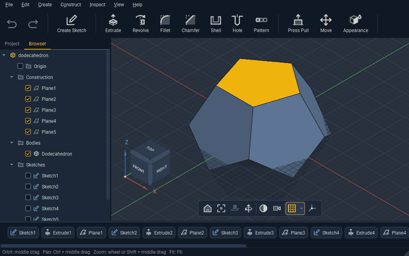

  
  
  
  
  
  
  

  <picture>
    <source media="(prefers-color-scheme: dark)" srcset="assets/branding/kalve137-wordmark.svg">
    
  </picture>

  <strong>Lean parametric CAD that lives on your disk.</strong> 
  Sketch, constrain and shape mechanical parts with a small tool set where every command earns its place. 
  Projects are folders and designs are files. No account. No cloud. No network.

> [!NOTE]
> Kalve 137 is in early development. Version 0.1 runs on 64-bit Windows 10 and 11. Linux follows.

## Install

1. Download `kalve137-0.1.0-windows-x64.zip` from [Releases](../../releases).
2. Unzip anywhere. Nothing is installed and nothing outside the folder changes apart from settings and autosave data.
3. Run `bin\kalve137.exe`. Dodecahedron above ships as `bin\samples\dodecahedron.k137`.

Zip carries its own Qt, OpenCascade and Visual C++ runtime. To check an unpacked copy without opening a window, run `kalve137.exe --smoke <design.k137> <output folder>`. It loads the design, renders it offscreen, exports STEP and STL and writes `smoke.txt`.

## Features

- Sketches with lines, arcs, circles, rectangles, polygons, trim, fillet, mirror and construction geometry
- Geometric constraints and driving dimensions solved by PlaneGCS, with labels placed where you click and a live preview while typing a value
- Sketches on construction planes or body faces that follow the face when the model changes
- Extrude with distance, symmetric, To Object and All extents and taper, revolve, fillet with several radius sets, chamfer, shell, hole, pattern, move and press pull
- Face and edge picks stored as topological names, so features rebuild after upstream edits
- Window and crossing selection that skips hidden edges
- Construction planes, axes and points
- Feature timeline with edit, suppress, roll back and undo
- STEP import and export with assemblies and colors, STL export
- Version history beside each design and autosave

## Known limits

- Windows only for now.
- Release binaries are not code signed yet. On Windows 11 with Smart App Control on, Windows can refuse to load them and show a Bad Image dialog with status `0xc0e90002`, so Kalve 137 does not start. It depends on Microsoft's cloud verdict on each file, which is most likely to block a release in its first days.
- Extrude To Object reaches planar faces and planes parallel to the sketch.
- An edge listed in two fillet sets takes the first set's radius.
- Window and crossing selection over a large import can take several seconds.
- Shell cannot open a face that runs smoothly into a round. That is an OpenCascade limit and the error message names a workaround.
- `.k137` format may still change before 1.0. Older files keep loading.

Report bugs and requests in [Issues](../../issues). Help, Report a Problem saves a zip with log and crash data to attach.

## Code

Source reads top to bottom without comments. Names, small functions and tests carry the intent, so nothing drifts out of date beside the code it describes. Only license headers and reasoned lint suppressions remain.

Every UI flow is tested headless. A hidden main window is driven through real clicks, drags and keys and saves screenshots of each step, so UI tests open nothing on screen.

## Build

Build steps and how to contribute are in [CONTRIBUTING.md](CONTRIBUTING.md). Changes per release are in [CHANGELOG.md](CHANGELOG.md).

## License

Kalve 137 is licensed under [GPL-3.0-or-later](LICENSE). Vendored code keeps its own license, listed in [REUSE.toml](REUSE.toml) with texts in [LICENSES](LICENSES). Libraries shipped in release zip are listed in [THIRD-PARTY-NOTICES.md](THIRD-PARTY-NOTICES.md) and in Help, About.
